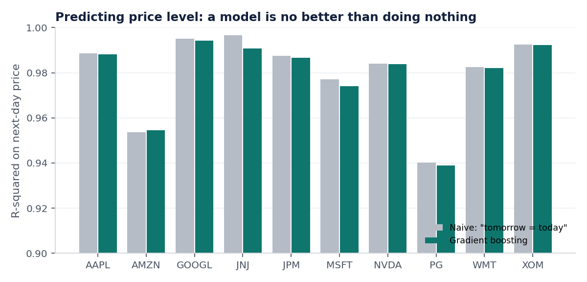
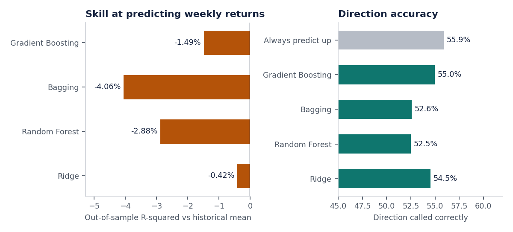
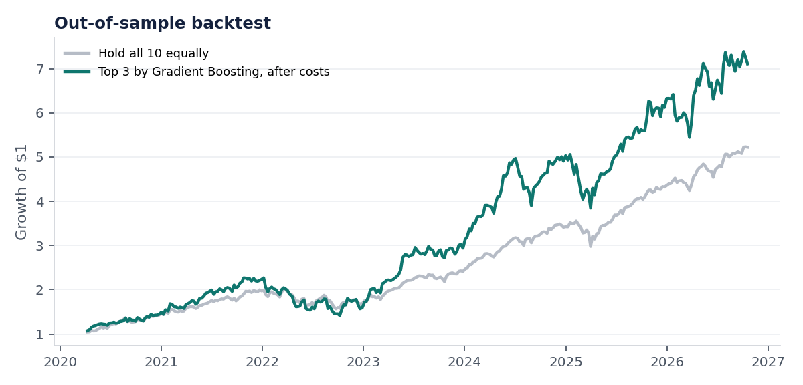

# Stock Trend Forecasting: what a 0.98 R² really means

[](https://github.com/VishChalla/stock-trend-forecasting/actions/workflows/ci.yml)


**Gradient boosting, bagging and random forest models on ten years of daily prices for ten large US stocks, evaluated the way a sceptical reviewer would.**

Stock prediction projects usually report an R² above 0.95 and stop. This one asks whether that number means anything. Short answer: it does not, and showing why is the point of the project.



## Finding 1: a high R² on price is free

Predicting tomorrow's closing price with gradient boosting gives an average **R² of 0.979** across the ten stocks. The rule "tomorrow's price equals today's price" gives **0.980**. Prices move a percent or so per day on top of a level in the hundreds, so any forecast that stays near today's price scores well. The model has learned nothing a one-line rule does not already know.

| | Mean R² | 
|---|---|
| Gradient boosting | 0.979 |
| Naive (no change) | 0.980 |

## Finding 2: on returns, nothing beats the baseline

The useful question is whether next week's *return* can be predicted. Using walk-forward validation (six expanding folds from 2020 to 2026, 16,450 out-of-sample predictions, a 5-day gap between train and test):

| Model | Out-of-sample R² vs historical mean | Direction accuracy |
|---|---|---|
| Always predict "up" | n/a | **55.9%** |
| Historical mean | 0.00% | 55.9% |
| Ridge | -0.42% | 54.6% |
| Gradient boosting | -1.49% | 55.0% |
| Random forest | -2.88% | 52.5% |
| Bagging | -4.06% | 52.6% |

Every model is worse than predicting the historical average return, and none calls direction better than always saying "up". The more flexible the model, the worse it does, which is what overfitting to noise looks like.



## Finding 3: a backtest that looks good until you look properly

Holding the three stocks gradient boosting ranks highest each week returned **35% a year** after trading costs, against 29% for simply holding all ten. That sounds like a win. It is not:

| | Top 3 by model | Hold all 10 |
|---|---|---|
| Annual return | 35.0% | 28.8% |
| Annual volatility | 26.2% | 16.1% |
| Sharpe ratio | 1.28 | **1.66** |
| Worst drawdown | -37.6% | **-21.9%** |

The strategy earns more only by concentrating into three stocks and taking far more risk. Per unit of risk it is worse than doing nothing clever.



## Method

| Step | Detail | Code |
|---|---|---|
| Data | Adjusted daily bars for AAPL, MSFT, AMZN, GOOGL, NVDA, JPM, XOM, JNJ, WMT, PG and SPY, 2016 to Oct 2026, from Yahoo Finance | [`data.py`](src/stockcast/data.py) |
| Features | 22 features: lagged returns, price against 10/50/200-day moving averages, volatility, RSI, volume, distance from 52-week high, market returns, relative strength | [`features.py`](src/stockcast/features.py) |
| Selection | `SelectKBest` (top 12 by F-score), fitted inside each fold so the test set never influences which features are chosen | [`evaluate.py`](src/stockcast/evaluate.py) |
| Models | Ridge, Random Forest, Bagging, Gradient Boosting | [`evaluate.py`](src/stockcast/evaluate.py) |
| Validation | Expanding walk-forward folds split by date, with a gap equal to the forecast horizon | [`evaluate.py`](src/stockcast/evaluate.py) |
| Backtest | Weekly rebalance, non-overlapping holding periods, 5 bps cost per unit of turnover | [`evaluate.py`](src/stockcast/evaluate.py) |

Safeguards against fooling myself, each with a test:

- **No look-ahead in features.** Tripling all future prices leaves today's features unchanged.
- **No overlap between train and test.** The gap between the last training day and first test day exceeds the forecast horizon.
- **The evaluation reports zero skill on pure noise.** Run on simulated random walks, the models show no skill, as they should.

## Run it

```bash
git clone https://github.com/VishChalla/stock-trend-forecasting.git
cd stock-trend-forecasting
pip install -e ".[dev]"
```

```bash
python -m stockcast
```

```bash
pytest -q
```

The first run downloads prices and caches them in `data/`. Tests use generated prices and need no network.

## Limitations

- Ten hand-picked large caps that all did well over the period, so there is survivorship bias in the universe and the equal-weight benchmark is flattering.
- Price and volume features only. No fundamentals, news or sentiment data, which is where any real edge is more likely to be.
- One six-year out-of-sample window covering one market regime. The Sharpe ratios have wide error bars.
- This is a study of evaluation method, not investment advice.

## Background

This replaces an earlier version of the project. I rebuilt it from scratch because the question I find more interesting now is not "how high can the score go" but "would this survive a careful review".

Built by [Vish Challa](https://github.com/VishChalla), MSc Supply Chain Management (Concordia) and BSc Computational Data Science (Michigan State).
